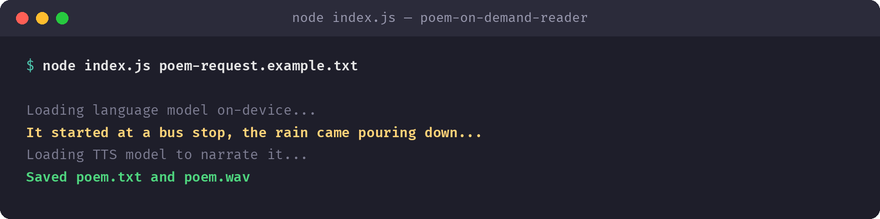

# poem-on-demand-reader

Writes a short poem on any topic or occasion and reads it aloud, on-device. Built with [Tether's QVAC SDK](https://github.com/tetherto/qvac) — the model runs on-device, so nothing leaves your machine.

## What it does

Writes a short poem on any topic or occasion and reads it aloud, on-device.

**QVAC functions used:** `loadModel`, `completion` and `textToSpeech`.



## Why I built it

Sometimes a card needs a poem and I need it read aloud to know if it's any good.

## Requirements

- Node.js >= 22
- `@qvac/sdk` `^0.19.0` (installed automatically via `npm install`)

## Install

```bash
git clone https://github.com/YURIIMII-byte/poem-on-demand-reader.git
cd poem-on-demand-reader
npm install
```

## Run

```bash
npm start
```

An example input is included: `poem-request.example.txt`.

See the comments at the top of `index.js` for the exact input this app expects. On first run, QVAC downloads the model it needs once and caches it locally; every run after that is fully offline.

## SDK version used

`@qvac/sdk` `0.19.1`

## License

MIT — see [LICENSE](LICENSE).
